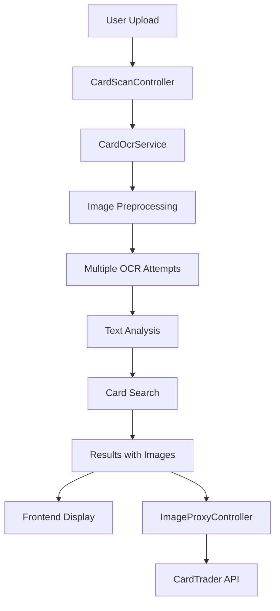

# 🔍 Sistema OCR per Riconoscimento Carte

## Panoramica

Il sistema OCR (Optical Character Recognition) di ItsMint è progettato per riconoscere automaticamente le carte trading card da immagini caricate o fotografate dagli utenti. Il sistema utilizza **Tesseract OCR** con configurazioni multiple e un sistema di ricerca intelligente per identificare le carte nel database.

## 🏗️ Architettura



## 📋 Componenti Principali

### 1. **CardOcrService**

_File: `app/Services/CardOcrService.php`_

Servizio principale che gestisce l'intero processo OCR:

- Preprocessing delle immagini
- Esecuzione OCR multipla
- Analisi del testo estratto
- Ricerca delle carte nel database

### 2. **CardScanController**

_File: `app/Http/Controllers/Api/CardScanController.php`_

Controller API che gestisce:

- Upload delle immagini
- Gestione degli endpoint di scansione
- Servizio delle immagini processate

### 3. **ImageProxyController**

_File: `app/Http/Controllers/Api/ImageProxyController.php`_

Proxy per servire immagini CardTrader evitando problemi CORS:

- Caching delle immagini (1 ora)
- Validazione degli URL
- Headers di sicurezza

### 4. **CardScan Model**

_File: `app/Models/CardScan.php`_

Modello Eloquent per memorizzare:

- Metadati delle scansioni
- Risultati OCR
- Carte rilevate
- Stati di elaborazione

## 🔄 Flusso di Elaborazione

### Fase 1: Upload e Validazione

```php
// Validazione input
$validated = $request->validate([
    'image' => [
        'required',
        File::image()->max(10 * 1024)->dimensions(
            Rule::dimensions()->minWidth(100)->minHeight(100)
        )
    ],
    'source' => 'sometimes|string|in:upload,camera'
]);
```

### Fase 2: Preprocessing Immagine

```php
private function preprocessImage(string $imagePath): string
{
    // 1. Resize intelligente (target: 1000px width)
    // 2. Conversione a scala di grigi
    // 3. Aumento contrasto (+40)
    // 4. Sharpening (+15)
    // 5. Salvataggio in PNG qualità 100%
}
```

### Fase 3: OCR Multiplo

Il sistema utilizza **3 configurazioni Tesseract**:

#### Metodo 1: Sparse Text (PSM 11)

```php
$ocr1 = new TesseractOCR($imagePath);
$ocr1->lang('eng');
$ocr1->psm(11); // Ottimale per carte con testo disperso
```

#### Metodo 2: Default Segmentation (PSM 3)

```php
$ocr2 = new TesseractOCR($imagePath);
$ocr2->lang('eng');
$ocr2->psm(3); // Segmentazione automatica pagina
```

#### Metodo 3: Single Line (PSM 7)

```php
$ocr3 = new TesseractOCR($imagePath);
$ocr3->lang('eng');
$ocr3->psm(7); // Tratta come singola linea di testo
```

### Fase 4: Analisi del Testo

#### Pattern Recognition per Codici Espansione

```php
$patterns = [
    '/\b([A-Z]{2,3}\d{2,3}[-\.]\d{2,3})\b/i',  // OP01-001, ST01-001
    '/\b([A-Z]{2,3}\s?\d{2,3}\s?[-\.]\s?\d{2,3})\b/i',  // OP 01-001
    '/\b(OP\d{2,3}[-\.]\d{2,3})\b/i',          // Specifico One Piece
    '/\b(ST\d{2,3}[-\.]\d{2,3})\b/i',          // Specifico Starter
    '/\b(\d{2,3}[-\.]\d{2,3})\b/',             // Solo numeri
];
```

#### Ricerca Intelligente

1. **Priorità Alta**: Codici di espansione (confidence 95%)
2. **Priorità Media**: Nomi delle carte (confidence variabile)
3. **Fallback**: Pattern numerici con prefisso OP01

### Fase 5: Risultati con Immagini

```php
private function getProxiedImageUrl(?string $originalUrl): ?string
{
    if (str_starts_with($originalUrl, 'https://cardtrader.com/uploads/')) {
        return url('/api/image-proxy?url=' . urlencode($originalUrl));
    }
    return $originalUrl;
}
```

## 🛠️ Configurazione Tesseract

### PSM (Page Segmentation Mode) Utilizzati

| PSM | Descrizione                     | Uso nel Sistema            |
| --- | ------------------------------- | -------------------------- |
| 3   | Segmentazione automatica pagina | Metodo primario robusto    |
| 7   | Singola linea di testo          | Testi lineari/codici       |
| 11  | Testo sparso                    | Carte con layout complesso |

### Lingue Supportate

- **eng**: Inglese (principale)
- **jpn**: Giapponese
- **ita**: Italiano

## 📡 API Endpoints

### POST `/api/card-scans/upload`

Upload e processamento immagine carta.

**Headers:**

```
Authorization: Bearer {token}
Content-Type: multipart/form-data
```

**Body:**

```json
{
  "image": "file",
  "source": "upload|camera"
}
```

**Response:**

```json
{
  "success": true,
  "scan": {
    "id": 123,
    "status": "completed",
    "confidence_score": 92.5,
    "detected_cards": [
      {
        "blueprint_id": 34,
        "name": "Shanks",
        "expansion": "Unnumbered Promos",
        "confidence": 100.0,
        "matched_text": "Shanks",
        "image_url": "http://localhost:8000/api/image-proxy?url=...",
        "card_number": "OP01-100"
      }
    ]
  }
}
```

### GET `/api/image-proxy`

Proxy per immagini CardTrader.

**Query Parameters:**

- `url`: URL encodato dell'immagine CardTrader

**Response Headers:**

```
Content-Type: image/jpeg
Cache-Control: public, max-age=3600
Access-Control-Allow-Origin: *
```

### GET `/api/card-scans/{id}/image`

Recupera l'immagine originale della scansione.

## 🎨 Frontend Integration

### Componente Vue: ScanResultsModal

_File: `resources/js/Components/ScanResultsModal.vue`_

#### Gestione Immagini

```vue
 console.log('Image loaded:', card.image_url)"
/>
```

#### Debug Console

Il componente logga automaticamente:

- Dati di scansione ricevuti
- Carte rilevate
- Errori di caricamento immagini
- Successi di caricamento

## 🚀 Performance

### Ottimizzazioni Implementate

1. **Caching Immagini**
   - Cache Redis/File per immagini proxy (1 ora)
   - Headers cache appropriati

2. **Preprocessing Intelligente**
   - Resize ottimale (1000px) per bilanciare qualità/velocità
   - Formato PNG per OCR migliore

3. **OCR Parallelo**
   - 3 metodi con fallback graceful
   - Timeout configurabili

4. **Database Queries**
   - Lazy loading con `with(['expansion'])`
   - Limit dei risultati (max 10)

### Metriche Tipiche

- **Tempo OCR**: 2-5 secondi per immagine 1000px
- **Accuratezza**: 85-95% per carte ben illuminate
- **Throughput**: ~10-15 scansioni/minuto

## 🔒 Sicurezza

### Validazioni Input

```php
// Dimensioni immagine
Rule::dimensions()->minWidth(100)->minHeight(100)

// Dimensione file
File::image()->max(10 * 1024) // 10MB max

// Formato file
'image' => ['required', File::image()]
```

### Proxy Sicuro

```php
// Solo immagini CardTrader permesse
if (!str_starts_with($url, 'https://cardtrader.com/uploads/')) {
    return response('Invalid image source', 403);
}
```

### Rate Limiting

- Autenticazione obbligatoria per upload
- Throttling implicito via Sanctum

## 🐛 Troubleshooting

### Problemi Comuni

#### 1. OCR Non Trova Testo

**Cause:**

- Immagine troppo scura/chiara
- Risoluzione insufficiente
- Angolazione errata

**Soluzioni:**

- Aumentare contrasto nel preprocessing
- Verificare dimensioni minime (100x100px)
- Suggerire foto migliore all'utente

#### 2. Immagini Non Si Caricano

**Cause:**

- Proxy non funzionante
- URL CardTrader cambiati
- Problemi CORS

**Debug:**

```bash
# Test proxy diretto
curl -I "http://localhost:8000/api/image-proxy?url=..."

# Check logs
docker compose exec php tail -f storage/logs/laravel.log
```

#### 3. Carte Non Riconosciute

**Cause:**

- Database non aggiornato
- Pattern codici non riconosciuti
- Threshold confidence troppo alto

**Soluzioni:**

- Verificare dati in Blueprint model
- Aggiornare pattern in `config/ocr.php` sezione `expansion_patterns`
- Ridurre threshold in `config/ocr.php` sezione `confidence.card_name_threshold`
- Modificare parametri di preprocessing in `config/ocr.php`

### Logs Utili

#### Livello INFO

```json
{
  "message": "OCR multiple attempts",
  "results": { "general": "...", "basic": "...", "lines": "..." },
  "combined": "testo finale combinato",
  "found_codes": ["OP01-100"]
}
```

#### Livello WARNING

```json
{
  "message": "OCR Method 2 failed",
  "error": "Tesseract error details"
}
```

## 🔧 Configurazione Ambiente

### File di Configurazione

_File: `config/ocr.php`_

Il sistema OCR utilizza un file di configurazione dedicato per tutti i parametri:

```php
// Upload settings
'upload' => [
    'max_file_size' => 10 * 1024, // KB (10MB)
    'min_width' => 100,
    'min_height' => 100,
],

// Image preprocessing
'preprocessing' => [
    'target_width' => 1000,
    'brightness' => 15,
    'contrast' => 40,
    'sharpen' => 15,
],

// Confidence thresholds
'confidence' => [
    'expansion_code_match' => 95.0,
    'card_name_threshold' => 70.0,
    'auto_assignment_threshold' => 80.0,
],

// OCR patterns
'expansion_patterns' => [
    '/\b([A-Z]{2,3}\d{2,3}[-\.]\d{2,3})\b/i',
    // ... altri pattern
],
```

### Dipendenze Docker

```dockerfile
# In php container
RUN apt-get update && apt-get install -y \
    tesseract-ocr \
    tesseract-ocr-eng \
    tesseract-ocr-jpn \
    tesseract-ocr-ita
```

### Variabili Ambiente

```env
# Storage
FILESYSTEM_DISK=public

# CardTrader API (per proxy immagini)
CARDTRADER_API_TOKEN=your_token_here
CARDTRADER_API_BASE_URL=https://api.cardtrader.com/api/v2

# OCR Debug (opzionale)
OCR_LOG_RESULTS=false
OCR_LOG_SEARCH=false
OCR_SAVE_PROCESSED=false
```

### Limiti Upload

```nginx
# nginx.conf
client_max_body_size 25M;
```

```ini
# php.ini
upload_max_filesize = 25M
post_max_size = 25M
```

## 📈 Metriche e Monitoring

### KPI da Monitorare

1. **Tempo di elaborazione OCR**
2. **Tasso di successo riconoscimento**
3. **Distribuzione confidence scores**
4. **Errori proxy immagini**
5. **Volume upload giornaliero**

### Logging Strutturato

Tutti i log seguono il formato JSON con campi consistenti:

- `timestamp`
- `level`
- `message`
- `context` (metadati specifici)

## 🔄 Estensioni Future

### Possibili Miglioramenti

1. **Machine Learning**
   - Training model personalizzato per carte TCG
   - Recognition layout specifici One Piece

2. **OCR Avanzato**
   - Google Vision API come fallback
   - AWS Textract per documenti complessi

3. **Performance**
   - Queue jobs per elaborazione asincrona
   - Caching intelligente risultati OCR

4. **Accuracy**
   - Preprocessing adattivo basato su qualità immagine
   - Feedback loop per migliorare pattern

5. **Scale**
   - Microservice dedicato per OCR
   - Load balancing per volumi alti

---

## 📚 Riferimenti

- **Tesseract Documentation**: https://tesseract-ocr.github.io/
- **Laravel File Storage**: https://laravel.com/docs/filesystem
- **Vue.js Composition API**: https://vuejs.org/guide/composition-api/
- **CardTrader API**: https://docs.cardtrader.com/

---

_Documentazione aggiornata: Giugno 2025_
_Versione Sistema: 1.0.0_
